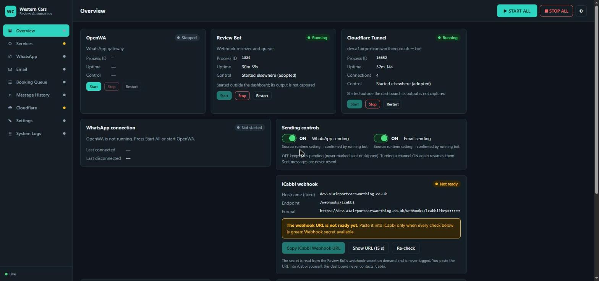
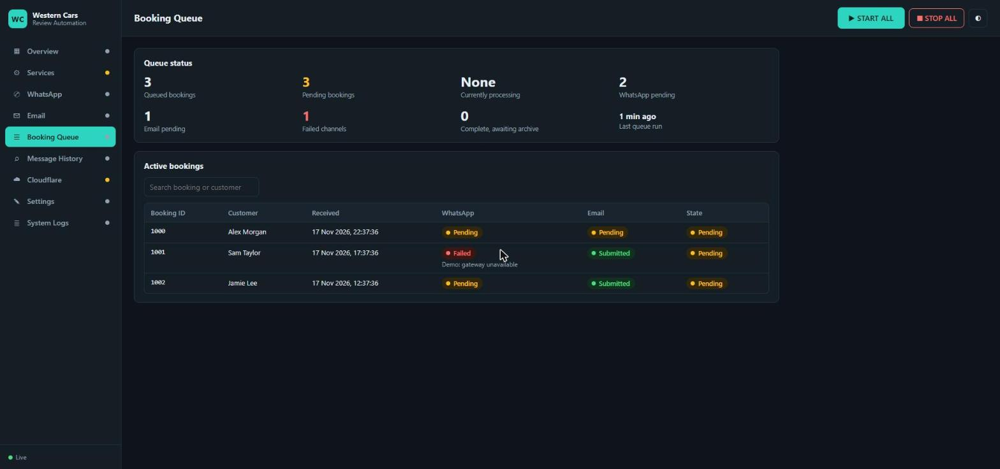
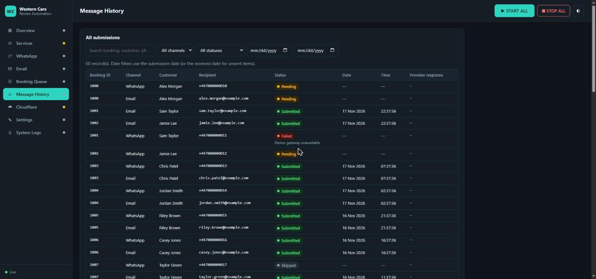

# Review Bot – Automated Customer Review Requests (WhatsApp + Email)

Automatically ask your customers for a Google review after every completed trip.
When your dispatch system (iCabbi) reports a booking as **completed**, the bot waits a few
minutes and then sends the customer a friendly review request by **WhatsApp** and/or **email**,
and a local **control dashboard** lets non-technical staff start/stop everything and watch what happened.

Built for a taxi / private-hire company, but it works for any business that can send a
"job completed" webhook (appointments, deliveries, repairs, restaurants, …).

> Screenshots below use **fictional demo data**.

| Overview | Booking queue | Message history |
|---|---|---|
|  |  |  |

---

## Features

- **Webhook receiver** for iCabbi `DISPATCH_BOOKING_COMPLETE` events (secret-protected).
- **WhatsApp** review requests through a self-hosted [OpenWA](https://github.com/rmyndharis/OpenWA) gateway.
- **Email** review requests through Microsoft Graph (Microsoft 365 / Outlook).
- **Safe sending**: random 2–5 min delay per booking, spacing between messages, daily cap,
  skip bookings older than 2 h, 3 message wordings, first-name greeting.
- **Opt-out**: a customer replying `STOP` is never messaged again.
- **No double sends**: interrupted sends are marked "unknown" and never auto-resent; failures back off and stop after 10 attempts.
- **Control dashboard** (Windows, zero dependencies): start/stop services, scan the WhatsApp QR code,
  turn WhatsApp/Email sending on or off, view the queue, full message history and logs.
- **Local-only & secure**: dashboard listens on `127.0.0.1` only, token + Host/Origin checks, secrets redacted from logs.

## Use cases

- **Taxi / chauffeur / airport transfer companies** – ask for a Google review right after the trip.
- **Any service business** with a "completed" event: salons, mechanics, cleaners, clinics, delivery firms.
- **Agencies** – run it for a client and give them the dashboard to pause WhatsApp or email.
- **Learning / reference** – a small example of webhooks, durable JSON queues, retry/back-off and provider abstraction.

## How it works

```
iCabbi  --(webhook: booking completed)-->  Cloudflare Tunnel  -->  Review Bot (Express, :3000)
                                                                       |
                                              queue (data/*.json) <----+
                                                                       |
                                  +------------------------------------+---------------+
                                  v                                                    v
                        OpenWA gateway (WhatsApp)                            Microsoft Graph (Email)
```

## Repository layout

| Folder | What it is |
|---|---|
| `WesternCarsReviewBot/` | The bot: webhook, queue, WhatsApp + email senders |
| `control-dashboard/` | Local web dashboard (Node, no `npm install` needed) |
| `openwa-gateway/` | OpenWA WhatsApp gateway (NestJS, upstream project, MIT) |
| `openwa-render-secure/` | Alternative lightweight WhatsApp provider (`@open-wa/wa-automate`) |
| `Start-Western-Cars-Dashboard.bat` | Windows one-click launcher for the dashboard |

## Requirements

- Node.js **18+** (22 LTS recommended) – <https://nodejs.org>
- A WhatsApp account/number you are allowed to automate (see the warning below)
- *(Email)* A Microsoft 365 tenant with an Entra ID (Azure AD) app registration that has the Graph `Mail.Send` application permission
- *(Webhooks from the internet)* A free Cloudflare account + [`cloudflared`](https://developers.cloudflare.com/cloudflare-one/connections/connect-networks/downloads/) and a domain, or any other way to expose the bot's port to iCabbi
- Windows for the dashboard/launcher (the bot itself runs anywhere Node runs)

## Quick start

### 1. Get the code and install
```bash
git clone https://github.com/<your-user>/<your-repo>.git
cd <your-repo>

cd WesternCarsReviewBot && npm ci && cd ..
cd openwa-gateway && npm ci && cd ..     # or follow openwa-gateway/README.md (Docker is supported)
```

### 2. Configure the bot
Create `WesternCarsReviewBot/.env` (never commit it):

```ini
PORT=3000
WEBHOOK_SECRET=<long random string>          # also saved in .webhook-secret for the dashboard
ENABLE_WHATSAPP=true
ENABLE_EMAIL=true

# WhatsApp via OpenWA gateway
WHATSAPP_PROVIDER=gateway
OPENWA_GATEWAY_URL=http://127.0.0.1:2785
OPENWA_GATEWAY_SESSION=<session name>
OPENWA_GATEWAY_API_KEY=<gateway API key>
WHATSAPP_REPLY_SECRET=<another long random string>   # for STOP replies

# Email via Microsoft Graph
MS_TENANT_ID=<tenant id>
MS_CLIENT_ID=<app (client) id>
MS_CLIENT_SECRET=<client secret>
EMAIL_FROM=reviews@yourcompany.com

# Optional safety settings
WA_MAX_AGE_HOURS=2
WA_DAILY_CAP=100
QUEUE_JITTER_MIN_MS=40000
QUEUE_JITTER_MAX_MS=120000
```

Generate a secret: `node -e "console.log(require('crypto').randomBytes(32).toString('hex'))"`

### 3. Use **your own** review link and wording  ⚠️
The Google review URL and message texts are currently written in
`WesternCarsReviewBot/server.js` (search for `g.page/r/` and `buildReviewMessage` / `sendReviewEmail`).
**Replace them with your business's review link and text before going live.**
The dashboard also has a fixed tunnel name and hostname in `control-dashboard/lib/config.js`
(`FIXED_HOSTNAME`, `TUNNEL_NAME`) – change these to your own.

### 4. Start everything
**Windows:** double-click `Start-Western-Cars-Dashboard.bat` → open <http://localhost:3001> → click **START ALL** →
scan the WhatsApp **QR code** shown in the dashboard with the phone you want to send from.

**Manual (any OS):**
```bash
cd WesternCarsReviewBot && node server.js     # bot on http://127.0.0.1:3000  (GET /health)
```

### 5. Connect your dispatch system
In iCabbi, add a webhook for *booking completed* pointing to:
```
https://<your-public-hostname>/webhooks/icabbi?key=<WEBHOOK_SECRET>
```
The dashboard's **Overview → iCabbi webhook** card shows this URL (hidden until you click **Show/Copy**).
To get started without iCabbi you can POST a test payload to the same URL.

### 6. Check it works
- **Booking Queue** shows incoming bookings and each channel's state.
- **Message History** lists every submission (`Submitted` = accepted by the provider, not necessarily delivered/read).
- **Sending controls** pause WhatsApp or Email instantly; paused jobs stay pending and resume when switched back on.

## Dashboard pages

| Page | Purpose |
|---|---|
| Overview | Service status, sending toggles, webhook URL |
| Services | Start / stop / restart OpenWA, bot and tunnel |
| WhatsApp | Live QR code and connection state |
| Email | Email channel status |
| Booking Queue | Pending / failed bookings |
| Message History | Searchable, filterable log of all sends |
| Cloudflare | Tunnel and DNS checks |
| Settings | Setup check (finds missing files/config), appearance |
| System Logs | Bot, OpenWA and tunnel logs |

## Tests
```bash
cd control-dashboard && npm test      # mocked providers, temp data, nothing is sent
```

## Security & privacy

- **Never commit** `.env`, `.webhook-secret`, `.openwa-session`, `.open-wa/`, `~/.cloudflared`, or anything in `data/` – it contains customer names, phone numbers and emails. The included `.gitignore` covers these; double-check with `git status` before pushing.
- If you ever committed a secret, **rotate it** (new webhook secret, API keys, Microsoft client secret).
- Review requests are marketing-adjacent messages: follow your local rules (UK PECR/GDPR, etc.), keep the "Reply STOP" line, and only message customers you are allowed to contact.

## ⚠️ WhatsApp account-safety warning

Automating a personal WhatsApp account through unofficial libraries can violate WhatsApp's Terms of
Service and **may get the number banned**. Use a dedicated number, keep volumes low (the built-in caps help),
and consider the official WhatsApp Business Platform for production use. Use at your own risk.

## Troubleshooting

| Symptom | Fix |
|---|---|
| Dashboard won't open | Install Node 18+; check port 3001 is free (`DASHBOARD_PORT` to change) |
| QR code not showing | Start OpenWA first; wait a few seconds; **WhatsApp** page refreshes automatically |
| Webhook "Not ready" | Settings → Setup check lists what's missing (secret, tunnel, DNS) |
| WhatsApp `HTTP 500 … requires … license` | The gateway refuses to start chats with new numbers on your plan/licence – see the OpenWA docs |
| Email not sending | Verify `MS_*` values and that the app has `Mail.Send` consent granted |

## Contributing

Issues and pull requests are welcome. Please never include real customer data or credentials in issues or screenshots.

## License

Add a `LICENSE` file for the code in this repository (MIT is a common choice).
`openwa-gateway/` is a copy of the upstream [OpenWA](https://github.com/rmyndharis/OpenWA) project and keeps its own MIT license and notices.

## Credits

- [OpenWA](https://github.com/rmyndharis/OpenWA) – WhatsApp API gateway
- [Express](https://expressjs.com), [@azure/msal-node](https://github.com/AzureAD/microsoft-authentication-library-for-js), [Cloudflare Tunnel](https://developers.cloudflare.com/cloudflare-one/connections/connect-networks/)
